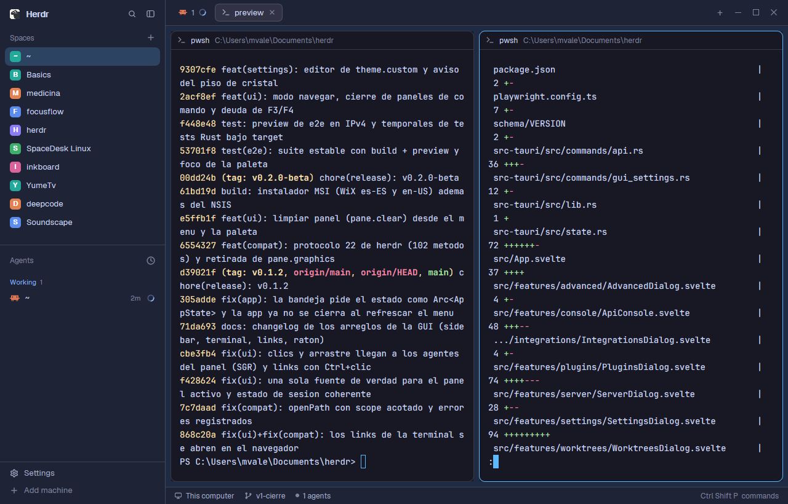
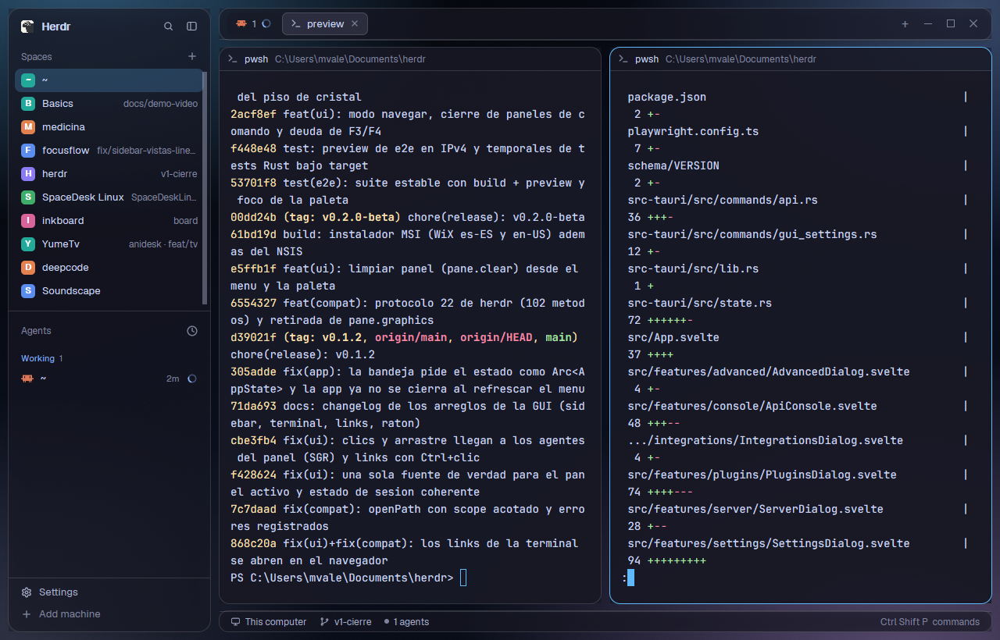

# herdr-layouts

Layouts for [Herdr](https://herdr.dev), styled after herdr-desk. One folder per layout,
each laid out like `~/.config/herdr-app` with its `RECIPE.md` and `preview.png`.

| Layout | |
|---|---|
| [`desk`](desk/RECIPE.md) — Herdr's window in herdr-desk's Catppuccin palette with a `#60b9fc` accent, light and dark |  |
| [`desk-glass`](desk-glass/RECIPE.md) — herdr-desk's glassmorphism: floating translucent cards over a glowing navy ambient |  |

To install one, copy its `layouts/`, `themes/` (and `backgrounds/`) into `~/.config/herdr-app`,
then `herdr-app do layout.switch '{"name":"desk"}'`.
