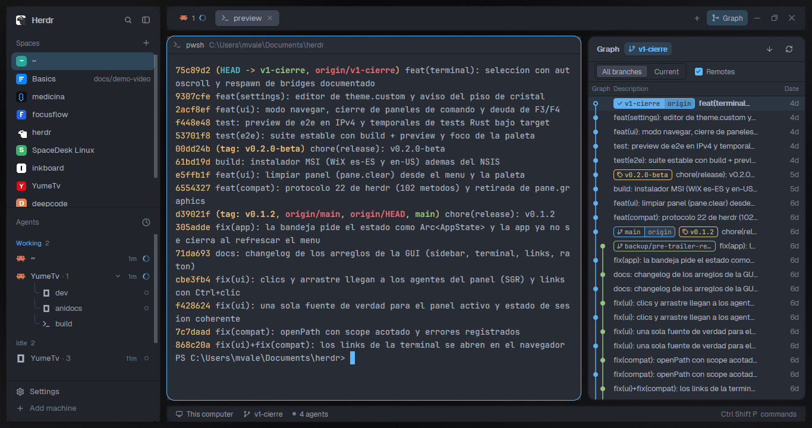

# Glass

The glassmorphism look of **herdr-desk** (the Tauri GUI for herdr) rebuilt in
Herdr, in neutral graphite: the interface floats as separate smoked-glass
cards (sidebar, tab bar, panes, status bar) over a near-black background with
faint white haze, with rounded corners, hairline white borders and shadows. No
colored glow behind the glass; color comes only from the text, the
`#60b9fc` accent and the agents' status. Dark only.

## What you see

The window has no system title bar. A background picture fills it
(`backgrounds/glass-ambient.png`, `cover`), and 10px of it shows around and
between every card (root padding 10, gap 10). Left to right, at zoom 1:

- **Background**: a 160° gradient `#070708` → `#111113` (55%) → `#08080a`
  with four soft white hazes (strongest top left, then bottom right, top
  right, bottom left) and faint grain. Reads about `#171718` at the top left
  corner. No hue.
- **Sidebar card**, 260px (44–480): `chrome` `#1a1a1e6b` (graphite at 42%),
  radius 16, 1px `#ffffff24` border, large shadow. Inside: Herdr brand row with
  search and fold (46px, drags the window); Spaces and Agents lists sharing the
  height (each at least 90px); Settings and Add machine (69px).
- **Work column**, 8px between its cards:
  - **Tab bar card**, 42px: same glass, radius 14, medium shadow; tab pills,
    `+` menu and window buttons; drags the window.
  - **Panes**: the active tab's panes as glass cards, radius 14, 10px apart,
    background `#1a1a1e99` (graphite at 60%), 1px `#ffffff24` border, focused
    pane 1px `#60b9fc`; 30px header on each (program icon, title, folder).
    Terminals draw at 72% opacity (`terminal_opacity: 0.72`).
  - **Files/Changes card** on the right, 368px (280–900), hidden at start,
    same glass as the sidebar.
  - **Status bar card**, 28px: glass, radius 12, medium shadow; machine,
    branch, agent count, palette hint.
- Text `#cdd6f4`, secondary `#a6adc8`, dim `#7f849c`; hover `#cdd6f41a`,
  selected rows `#60b9fc38`; menus and dialogs on `popover` `#1a1a1eeb` (92%);
  raised controls `#2c2c32cc`; buttons `#60b9fc` with `#14151c` text. Terminal
  cursor `#60b9fc`, selection `#45475a`, padding 14px × 12px. Fonts: Herdr's
  defaults, JetBrains Mono 14 and Geist.
- **Project icons on the space avatars**: in the Spaces list, each space whose
  project has an icon shows it on its 18px avatar (radius 5), in full color.
  Spaces without one keep Herdr's colored letter tile.
- **Graph button** in the tab bar, right of `+`, when the git-graph mod
  (github.com/rabeeh-ta/herdr-git-graph) is installed: a 26px pill (radius 6,
  14px graph icon, "Graph" at 12px, `muted` on `chrome`, `selected` when its
  panel shows). It opens the side panel (368px) with Git Graph's commit graph of
  the focused terminal's repository. Without git-graph the button isn't drawn.

## How it behaves

- Agent status in the shipped mods (agents list, tab pills, status bar):
  **working** `#89b4fa`, **blocked** `#f9e2af`, **done** `#a6e3a1`, **idle**
  `#6c7086`, unknown `#cba6f7`.
- Everything else is Herdr (main): click a space or tab to show it, `+` starts
  a terminal or an agent, the tab bar opens Files/Changes, `ctrl-shift-b` folds
  the sidebar, `ctrl-shift-l` cycles layouts, panes drag by the top-center grip.
- Nothing animates; the background is a still picture.
- **Project icons**: for each space on this computer, the `spaces-icons` mod
  looks in its project folder (the git repo's top, else where its first terminal
  is, else where the space was made; never the home folder) for, in this order:
  `.herdr/icon.svg|png` (an override), Tauri icons
  (`src-tauri/icons/128x128@2x.png`, `128x128.png`, `icon.png`), `icon.*`,
  `logo.*`, `assets/`, `build/`, `resources/`, `src/app/`, `public/`,
  `src/assets/`, `.github/`, `docs/` logos and icons, then favicons
  (`public/favicon.svg`, ...). Each candidate is tried in the folder itself, its
  subfolders and `apps/*` / `packages/*`, so monorepos work. The first hit
  wins; PNGs under 16px wide are skipped as placeholders. The first search of
  all projects takes a few seconds, one project at a time. After that the
  results live in shared state: a layout or theme change starts a new copy of
  the mod, which inherits them and searches nothing. A project is looked at
  again only when it is new or its result is a day old.
- **Graph**: clicking the button selects `graph` in the side panel's stack and
  shows the panel; clicking it again while it shows hides the panel, like Files
  and Changes. Everything inside the panel is git-graph's own (lanes, labels,
  checkout on double-click, right-click menus, commit details).

## Built from

- `layouts/glass.json`: the shipped `main` tree, restyled. Root: `row`,
  `titlebar: "none"`, `traffic_lights: [12, 16]`, `theme: "glass"`,
  `preview: "layouts/glass.png"`,
  `background: { "image": "backgrounds/glass-ambient.png", "fit": "cover" }`,
  `padding: 10`, `gap: 10`, `terminal_padding: [14, 12]`,
  `terminal_opacity: 0.72`, no divider.
  - `sidebar` (column, 260px, min 44, max 480, `resizable: false`, background
    `chrome`, radius 16, border 1 `border`, shadow `lg`): `brand` (46px,
    `window_drag`, mod `workspace-chrome`), `sidebar-lists` column with
    `spaces` (mod `spaces-icons`) and `agents` (weight 1, min 90), `sidebar-footer` (69px, mod
    `workspace-chrome`, props `{ "footer": true }`).
  - `work` (column, gap 8, `resizable: false`): `tabs` (42px, `window_drag`, mod
    `tabs-graph`, `chrome`, radius 14, border 1 `border`, shadow `md`); `work-body`
    row (padding 0, gap 10) with `main` (`{ "tab": "active" }`, pane frame gap
    10, radius 14, background `background`, `lone: true`, border 1 `border`,
    focus 1 `accent`, header mod `pane` 30px top `reveal: "always"`) and a
    hidden `panel` column (368px, 280–900, glass like the sidebar) holding a
    `stack` of `files` and `changes`; `status` (28px, mod `workspace-status`,
    `chrome`, radius 12, border, shadow `md`).
- Mods: `spaces-icons` (below) for the Spaces list, `tabs-graph` (below) for
  the tab bar, and the shipped
  `workspace-chrome`, `agents`, `pane`, `files`, `changes`,
  `workspace-status`.
- `themes/glass.json` (named like the layout, so it is the layout's own):
  top level `background` `#1a1a1e`, `foreground` `#cdd6f4`, `selection`
  `#45475a`, `cursor` `#60b9fc`, `ansi` (Catppuccin Mocha)
  `#1e1e2e #f38ba8 #a6e3a1 #f9e2af #89b4fa #cba6f7 #94e2d5 #cdd6f4
  #6c7086 #ea9ebb #b0e0b6 #eedfc0 #9abdf9 #ccb2f6 #a2dfdd #cdd6f4`.
  `colors` with alpha: `background` `#1a1a1e99`, `canvas` `#0e0e10`, `chrome`
  `#1a1a1e6b`, `surface` `#1a1a1e80`, `popover` `#1a1a1eeb`, `raised`
  `#2c2c32cc`, `hover` `#cdd6f41a`, `selected` `#60b9fc38`, `border`
  `#ffffff24`, `input` `#ffffff33`, `muted` `#a6adc8`, `dim` `#7f849c`,
  `accent`/`solid` `#60b9fc`, `accent_foreground`/`solid_foreground` `#14151c`,
  status colors as above.
- Art: `backgrounds/glass-ambient.png`, 2560×1640, made by
  `tools/ambient.ps1` (Windows PowerShell + System.Drawing:
  `powershell -File tools/ambient.ps1 -Out backgrounds/glass-ambient.png`).
  Each haze is a white radial ellipse blended over the gradient with strength
  falling linearly to 0 at its edge: 9%, 1536×1088px at (8%, −6%), edge at
  62%; 5%, 1344×960 at (96%, 2%), 64%; 7%, 1728×1280 at (90%, 106%), 66%; 4%,
  1280×960 at (2%, 98%), 62%; grain ±2%. Same geometry as herdr-desk's
  `app.css` ambient blobs, scaled 2×, with the color taken out.
- The glass values follow herdr-desk's layers: surface (sidebar, bars) ≈ 42%,
  panes ≈ 60%, elevated (menus) ≈ 92%, borders white 14% / 20%, radii
  16/14/12px.
- `mods/spaces-icons/`: a clone of the shipped `spaces` mod
  (`herdr-app do mod.clone '{"name":"spaces","as":"spaces-icons"}'`), used by the
  `spaces` block instead of `spaces`. Its changes:
  - `icons.js`: `findIcon(root)` lists the folders once (`fs.readdir`), skips
    candidates whose first path part isn't there, checks the rest with
    `fs.exists`, reads a PNG's width from its header, and copies the hit into
    `data/spaces-icons/<hash of path>.<svg|png>` in the Herdr home, because
    `image()` only reads paths relative to the home. SVGs are copied as text
    (`fs.readFile` utf8 + `fs.writeFile`); PNGs with `exec("cmd", ["/c",
    "copy", "/y", src, dest])` on Windows, `exec("cp", [src, dest])` elsewhere.
  - `main.js`: `roots(space, panes)` gives the project folders.
    `init` loads `shared("spaces-icons.found")` (`{folder: {icon: path|null, at}}`).
    Every 8th 250ms `checkNew` tick (2s), `lookForIcons` queues only folders
    missing from it or older than 24h, searches the queue in one task, one
    folder at a time, and writes the map back with one `setShared` when done. `grouped` reads
    `panes()` once per render and passes each row its `icon`; `row` draws
    `div().size(18).rounded(5).overflow_hidden().child(image(icon).size(18))`,
    else the original letter tile. Everything else is the shipped `spaces`.
- `mods/tabs-graph/`: a clone of the shipped `tabs` mod
  (`herdr-app do mod.clone '{"name":"tabs","as":"tabs-graph"}'`), used by the
  `tabs` block, following git-graph's `docs/top-bar.md`. Its changes:
  - `init(_props, cx)` checks once, with `fs.exists`, for
    `<appHome>/mods/git-graph/main.js` and sets `this.hasGraph`.
  - The enabled panels become `[...(shared("workspace.panels") ?? ["files",
    "changes"]), ...(this.hasGraph ? ["graph"] : [])]`.
  - After the Changes button: `.when(enabled.includes("graph"), el =>
    el.child(panelButton("graph", "Graph", "mods/git-graph/icons/graph.svg")))`.
- The `panel-body` stack gets a third child after `files` and `changes`:
  `{ "id": "graph", "type": "block", "content": { "mod": "git-graph" } }`.
- `mods/git-graph/` itself isn't in this repo: install it from
  github.com/rabeeh-ta/herdr-git-graph (MIT). It runs `git` in the focused
  repository, reads the repositories open in other spaces ahead every 15s, and
  reaches the network only through git (Fetch, Push, deleting a remote branch).

## Watch out

- Without `mods/git-graph/` the Graph button is hidden but the `graph` block
  is still in the stack; nothing opens it, so it stays unseen.
- `tabs-graph` is a frozen copy of Herdr 0.1.10's `tabs`: a Herdr release that
  changes the tab bar won't reach it. Clone `tabs` again and redo the three edits.
- Each layout keeps its own panel state: opening Graph in one layout doesn't open
  it in another.

- `spaces-icons` reads files outside its own folder (the projects of your
  spaces) and runs a program to copy PNG icons (`cmd /c copy` on Windows,
  `cp` elsewhere). It writes only under `data/spaces-icons/` and the shared key
  `spaces-icons.found`. No network.
- `image("C:/abs/path.png")` draws nothing: icons must be copied into the home.
  `fs.writeFile` with the `Uint8Array` from `fs.readFile` wrote 0-byte files
  in this build, hence the system copy for PNGs.
- Reading `panes()` inside each row made the list too slow to render ("This view
  could not be re-rendered"); read it once per render.
- Spaces on other machines and the `~` space keep the letter tile. `.ico`
  favicons aren't used (GPUI doesn't draw them). A new or changed icon shows
  within a day (or delete `data/spaces-icons/` and the shared key to look again
  now).
- Don't search per mod copy: each layout switch and theme change starts the
  mods fresh, so a per-run search redid every project's disk scan on every
  switch. Searching in parallel and calling `setShared` per result also made
  every mod redraw once per project.
- Switching layouts in Herdr itself froze the window for up to ~5s in testing,
  with the shipped `main`/`terminals` layouts and with the shipped `spaces`
  mod too; it isn't this mod.
- The rail (sidebar narrower than 160px) shows numbers, as the shipped mod does,
  not icons.

- Herdr draws translucency but no backdrop blur; herdr-desk's glass is frosted
  over Windows acrylic, here it is plain see-through. Over a background this
  dark the cards read mostly through their borders, shadows and the haze in
  the gaps.
- Only `colors` take alpha; keep the theme's top-level `background`,
  `foreground` and `ansi` opaque `#rrggbb`.
- Dark only: one background picture can't follow light/dark.
- Background pictures are cached: after replacing the PNG, rename it (and the
  layout's path) or restart Herdr.
- Most programs paint their own terminal background, so terminals stay nearly
  opaque even at `terminal_opacity: 0.72`.
- `sidebar.resizable` stays `false`; `true` makes the brand/lists/footer
  boundaries draggable, not the sidebar's width.
- A theme pick in Settings > Look is saved per layout in `layouts/.state/` and
  beats the file; reset with `herdr-app do app.theme '{"name":"glass"}'`.
- `herdr-app shot` returns the last rendered frame; let the window redraw
  after a change.

## Done when

- `herdr-app do layout.switch '{"name":"glass"}'` shows it and
  `herdr-app status` lists no errors.
- A screenshot shows separate rounded cards with `#ffffff24` borders and 10px
  of background between them; background and sidebar pixels are neutral grays
  (about `#171718` at the top left corner, `#17171a` in the sidebar), never
  blue or purple; the focused pane's border is `#60b9fc`.
- `themes()` from a mod lists `glass` with `chrome` `#1a1a1e6b`.
- `herdr-app check mods/spaces-icons` passes.
- A space whose repo has `src-tauri/icons/128x128.png` shows that picture on its
  avatar within about 10 seconds, and `data/spaces-icons/` holds a non-empty copy;
  a space with no icon file shows its colored letter.
- `herdr-app check mods/tabs-graph` passes. With git-graph installed, Graph
  shows in the tab bar and opens a commit graph of the focused terminal's repo
  (`Not a git repository` outside one); with it removed, the button is gone.
