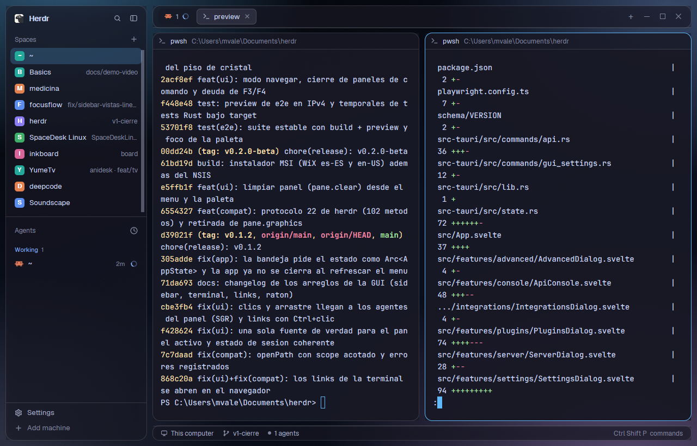

# Desk Glass

The glassmorphism look of **herdr-desk** (the Tauri GUI for herdr) rebuilt
in Herdr: a deep navy ambient with soft sky-blue, blue, lavender and slate
glows, and the whole interface floating over it as separate smoked-glass
cards (sidebar, tab bar, panes, status bar) with rounded corners, hairline
white borders and shadows. The glows show through every card. Catppuccin
Mocha colors with a `#60b9fc` accent. Dark only.

## What you see

The window has no system title bar. A background picture fills it
(`backgrounds/desk-glass-ambient.png`, `cover`), and 10px of it shows around
and between every card (root padding 10, gap 10). Left to right, at zoom 1:

- **Ambient** (behind everything): a 160° gradient `#050609` → `#0b1020` (55%)
  → `#080b12`, with four soft elliptical glows: sky blue `#60b9fc` at the top
  left, blue `#89b4fa` at the top right, lavender `#cba6f7` at the bottom right,
  slate `#6c7086` at the bottom left, plus faint grain.
- **Sidebar card**, 260px (44–480): `chrome` `#1818256b` (Mocha panel at 42%),
  radius 16, 1px `#ffffff24` border, large shadow. Inside: Herdr brand row with
  search and fold (46px, drags the window); Spaces and Agents lists sharing the
  height (each at least 90px); Settings and Add machine (69px).
- **Work column**, 8px between its cards:
  - **Tab bar card**, 42px: same glass, radius 14, medium shadow; tab pills, `+`
    menu and window buttons; drags the window.
  - **Panes**: the active tab's panes as glass cards, radius 14, 10px apart,
    background `#18182599` (panel at 60%), 1px `#ffffff24` border, focused pane
    1px `#60b9fc`; 30px header on each (program icon, title, folder).
    Terminals are drawn at 72% opacity (`terminal_opacity: 0.72`), so the
    glows tint them faintly.
  - **Files/Changes card** on the right, 368px (280–900), hidden at start,
    same glass as the sidebar.
  - **Status bar card**, 28px: glass, radius 12, medium shadow; machine,
    branch, agent count, palette hint.
- Text `#cdd6f4`, secondary `#a6adc8`, dim `#7f849c`; hover `#cdd6f41a`,
  selected rows `#60b9fc38`; menus and dialogs on `popover` `#181825eb`
  (92%); raised controls `#313244cc`; buttons `#60b9fc` with `#14151c` text.
  Terminal cursor `#60b9fc`, selection `#45475a`, padding 14px × 12px.
  Fonts: Herdr's defaults, JetBrains Mono 14 and Geist.

## How it behaves

- Agent status in the shipped mods (agents list, tab pills, status bar) uses the
  theme's colors: **working** `#89b4fa`, **blocked** `#f9e2af`, **done**
  `#a6e3a1`, **idle** `#6c7086`, unknown `#cba6f7`.
- Everything else is Herdr (main): click a space or tab to show it, `+` starts
  a terminal or an agent, the tab bar opens Files/Changes, `ctrl-shift-b` folds
  the sidebar, `ctrl-shift-l` cycles layouts, panes drag by the top-center grip.
- Nothing animates; the ambient is a still picture.

## Built from

- `layouts/desk-glass.json`: the shipped `main` tree, restyled.
  Root: `row`, `titlebar: "none"`, `traffic_lights: [12, 16]`,
  `theme: "desk-glass"`, `preview: "layouts/desk-glass.png"`,
  `background: { "image": "backgrounds/desk-glass-ambient.png", "fit": "cover" }`,
  `padding: 10`, `gap: 10`, `terminal_padding: [14, 12]`,
  `terminal_opacity: 0.72`, no divider.
  - `sidebar` (column, 260px, min 44, max 480, `resizable: false`,
    background `chrome`, radius 16, border 1 `border`, shadow `lg`): `brand`
    (46px, `window_drag`, mod `workspace-chrome`), `sidebar-lists` column with
    `spaces` and `agents` (weight 1, min 90), `sidebar-footer` (69px, mod
    `workspace-chrome`, props `{ "footer": true }`).
  - `work` (column, gap 8, `resizable: false`): `tabs` (42px, `window_drag`,
    mod `tabs`, `chrome`, radius 14, border 1 `border`, shadow `md`);
    `work-body` row (padding 0, gap 10) with `main` (`{ "tab": "active" }`,
    pane frame gap 10, radius 14, background `background`, `lone: true`,
    border 1 `border`, focus 1 `accent`, header mod `pane` 30px top
    `reveal: "always"`) and a hidden `panel` column (368px, 280–900, glass like
    the sidebar) holding a `stack` of `files` and `changes`; `status` (28px,
    mod `workspace-status`, `chrome`, radius 12, border, shadow `md`).
- Mods: only shipped ones (`workspace-chrome`, `spaces`, `agents`, `tabs`,
  `pane`, `files`, `changes`, `workspace-status`). No custom code, no programs
  run, no network.
- `themes/desk-glass.json` (named like the layout, so it is the layout's own):
  Catppuccin Mocha. `background` `#181825`, `foreground` `#cdd6f4`,
  `selection` `#45475a`, `cursor` `#60b9fc`, `ansi`
  `#1e1e2e #f38ba8 #a6e3a1 #f9e2af #89b4fa #cba6f7 #94e2d5 #cdd6f4
  #6c7086 #ea9ebb #b0e0b6 #eedfc0 #9abdf9 #ccb2f6 #a2dfdd #cdd6f4`. Its
  `colors` carry alpha, which Herdr accepts: `background` `#18182599`,
  `canvas` `#0b1020`, `chrome` `#1818256b`, `surface` `#18182580`, `popover`
  `#181825eb`, `raised` `#313244cc`, `hover` `#cdd6f41a`, `selected`
  `#60b9fc38`, `border` `#ffffff24`, `input` `#ffffff33`, `muted` `#a6adc8`,
  `dim` `#7f849c`, `accent`/`solid` `#60b9fc`, `accent_foreground`/`solid_foreground`
  `#14151c`, status colors as above.
- Art: `backgrounds/desk-glass-ambient.png`, 2560×1640, made by
  `tools/ambient.ps1` (Windows PowerShell + System.Drawing:
  `powershell -File tools/ambient.ps1 -Out backgrounds/desk-glass-ambient.png`).
  Glows are radial ellipses blended over the gradient with strength falling
  linearly to 0 at their edge: sky blue 46%, 1536×1088px at (8%, −6%), edge at
  62%; blue 36%, 1344×960 at (96%, 2%), 64%; lavender 42%, 1728×1280 at
  (90%, 106%), 66%; slate 38%, 1280×960 at (2%, 98%), 62%; grain ±2%.
  These are herdr-desk's `app.css` blobs scaled 2× and boosted, because Herdr
  has no backdrop blur.

## Watch out

- Herdr draws translucency but no backdrop blur. herdr-desk's glass is
  frosted (30–48px blur over Windows acrylic); here the cards are plain
  see-through. Opacities are higher than herdr-desk's to keep text readable,
  and the glows are stronger so they still show. Don't drop `chrome` below about
  40% or the sidebar text starts fighting the glows.
- Only alpha in `colors` works; keep the top-level `background`/`foreground`/`ansi`
  of the theme file opaque `#rrggbb`.
- Dark only: one background picture can't follow light/dark, and the glass
  colors are dark panel tints. A `{light, dark}` theme would put light text
  rules on a dark ambient.
- Background pictures are cached: after replacing the PNG, rename it (and the
  layout's path) or restart Herdr to see the change.
- Most programs paint their own terminal background, so terminals stay nearly
  opaque even at `terminal_opacity: 0.72`, like herdr-desk's own "almost
  opaque" terminal layer.
- `sidebar.resizable` must stay `false`; `true` makes the brand/lists/footer
  boundaries draggable, not the sidebar's width.
- A theme pick in Settings > Look is saved per layout in `layouts/.state/`
  and beats the file; reset it with `herdr-app do app.theme '{"name":"desk-glass"}'`.
- `herdr-app shot` returns the last rendered frame; let the window redraw
  after a change.

## Done when

- `herdr-app do layout.switch '{"name":"desk-glass"}'` shows it and
  `herdr-app status` lists no errors.
- A screenshot shows the glows in the 10px margins (the top left corner
  pixel is about `#23425b`) and through the sidebar card, which is bluer at
  the top (about `#171d2b`) than at the bottom (about `#181a27`).
- Sidebar, tab bar, panes and status bar are separate rounded cards with
  `#ffffff24` borders; the focused pane's border is `#60b9fc`.
- `themes()` from a mod lists `desk-glass` with `chrome` `#1818256b`.
