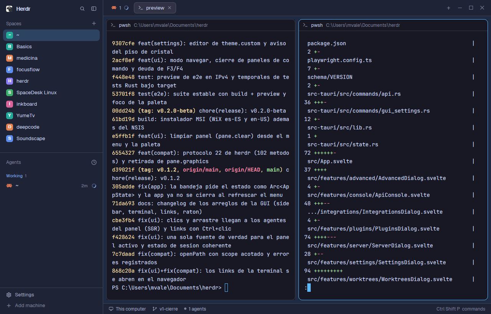

# Desk

Herdr's own window (spaces and agents on the left, tabs as pills, panes as
cards, a status bar) dressed in the palette of **herdr-desk**, the Tauri GUI
for herdr: Catppuccin Mocha panels with a sky-blue `#60b9fc` accent in dark
mode, Catppuccin Latte with the same accent in light mode. It follows the
system's light/dark appearance by itself.

## What you see

Left to right, at zoom 1:

- **Sidebar**, 268px wide (44–480), on `chrome` (`#1e2336` dark,
  `#e4e7ef` light), no system title bar:
  - top 46px: the Herdr brand row with search and fold buttons (drags the window);
  - Spaces list and Agents list, sharing the height equally (each at least 90px);
  - bottom 69px: Settings and Add machine.
- A 1px `border` divider (`#ffffff24` dark, `#0000001f` light).
- **Work column** on `canvas` (`#1e2b43` dark, a navy tinted by the accent;
  `#d7dbf0` light):
  - top 42px: tabs as pills with a `+` menu and the window buttons (drags the window);
  - the active tab's panes as cards, 8px padding and 8px gaps, radius 10,
    on `background` (`#181825` dark, `#eff1f5` light), 1px `border`;
    the focused pane gets a 1px accent `#60b9fc` border. Each pane has a
    30px header on top (program icon, title, folder);
  - an optional Files/Changes panel on the right, 368px (280–900), hidden at start;
  - bottom 28px: status bar (machine, branch, agent count, palette hint).
- Terminals: Catppuccin text `#cdd6f4` on `#181825` (Latte `#4c4f69` on
  `#eff1f5`), cursor `#60b9fc`, selection `#45475a` (`#bcc0cc`), padding
  14px × 12px. Fonts are Herdr's defaults: JetBrains Mono 14 and Geist.

Other theme colors: `surface` `#1a1d2d`, `popover` `#20202e`, `raised`
`#313244`, `hover` `#cdd6f41a`, `selected` `#60b9fc38`, `input` `#ffffff33`,
`muted` `#a6adc8`, `dim` `#7f849c`; buttons are `#60b9fc` with `#14151c` text.

## How it behaves

- Agent status uses the theme's status colors in the shipped mods (sidebar
  agents list, tab pills, status bar): **working** `#89b4fa` (light
  `#1e66f5`), **blocked** `#f9e2af` (`#df8e1d`), **done** `#a6e3a1`
  (`#40a02b`), **idle** `#6c7086` (`#9ca0b0`), unknown `#cba6f7` (`#8839ef`).
- Everything else is Herdr (main): click a space or tab to show it, `+` starts
  a terminal or an agent, the tab bar opens Files/Changes, `ctrl-shift-b` folds
  the sidebar to a 44px rail, `ctrl-shift-l` cycles layouts, panes drag by the
  top-center grip.
- The theme follows the system appearance; Settings > Look can pick another
  theme for this layout.

## Built from

- `layouts/desk.json`: a copy of the shipped `main` layout tree with two root
  additions: `"theme": { "light": "herdr-desk-light", "dark": "herdr-desk" }`
  and `"preview": "layouts/desk.png"`. Root: `row`, `titlebar: "none"`,
  `traffic_lights: [12, 16]`, `background: "canvas"`, `terminal_padding: [14, 12]`,
  divider 1px `border`.
  - `sidebar` (column, 268px, `chrome`, `resizable: false`): `brand` block
    (46px, `window_drag`, mod `workspace-chrome`), `sidebar-lists` column with
    `spaces` and `agents` blocks (weight 1, min 90), `sidebar-footer` block
    (69px, mod `workspace-chrome`, props `{ "footer": true }`).
  - `work` (column, `resizable: false`): `tabs` block (42px, `window_drag`, mod
    `tabs`), `work-body` row (padding 8, gap 8) with `main` block
    (`{ "tab": "active" }`, pane frame: gap 8, radius 10, background
    `background`, `lone: true`, border 1 `border`, focus 1 `accent`, header mod
    `pane`, 30px, top, `reveal: "always"`) and a hidden `panel` column (368px)
    holding a `stack` of `files` and `changes` blocks; `status` block (28px, mod
    `workspace-status`).
- Mods: only shipped ones (`workspace-chrome`, `spaces`, `agents`, `tabs`,
  `pane`, `files`, `changes`, `workspace-status`). No custom code, no
  programs run, no network.
- `themes/herdr-desk.json` and `themes/herdr-desk-light.json`, generated from
  herdr-desk's tokens (Catppuccin Mocha / Latte, as transcribed from herdr):
  - `background` = herdr `panel_bg`, `foreground` = `text`, `selection` =
    `surface1`, `cursor` = accent.
  - `ansi`: black `surface_dim`, red/green/yellow/blue/magenta(`mauve`)/cyan(`teal`)/white(`text`),
    bright black `overlay0`, other brights = color mixed 25% toward `text`.
  - `colors`: `canvas` = base `#0b1020` (light `#e7e7ef`) mixed 12% (10%)
    toward the accent and 5% (4%) toward mauve; `chrome` = canvas mixed 60%
    (85%) toward `surface_dim`; `surface` = canvas mixed 75% (90%) toward
    `panel_bg`; `hover` = text at 10%, `selected` = accent at 22%, `border`
    white at 14% (light: black at 12%), `input` white 20% (black 16%), `muted`
    = `subtext0`, `dim` = `overlay1`, status colors as above.

## Watch out

- The theme files are named differently from the layout on purpose: a theme
  named like a layout (`themes/desk.json`) would belong only to that layout,
  and these two are also meant for `settings.json`'s `theme`.
- The accent `#60b9fc` is the person's own `[theme.custom] accent`, not
  Catppuccin's `#89b4fa`. On the light theme it is low contrast as a text
  color; Herdr's mods use it for borders and fills, where it reads fine.
- A theme pick in Settings > Look is stored per layout in `layouts/.state/`
  and beats the layout file; if the colors don't change, pick Desk's themes
  there or run `herdr-app do app.theme '{"name":"herdr-desk"}'`.
- `herdr-app shot` returns the last rendered frame: after a theme change,
  wait for the window to redraw before trusting a screenshot.

## Done when

- `herdr-app do layout.switch '{"name":"desk"}'` shows the layout and
  `herdr-app status` lists no errors.
- With a dark system appearance, the sidebar pixel reads `#1e2336`, an empty
  terminal reads `#181825` and the focused pane's border is `#60b9fc`.
- In light appearance the terminal reads `#eff1f5` with `#4c4f69` text.
- `themes()` from a mod lists `herdr-desk` (`light: false`) and
  `herdr-desk-light` (`light: true`) with those colors.
